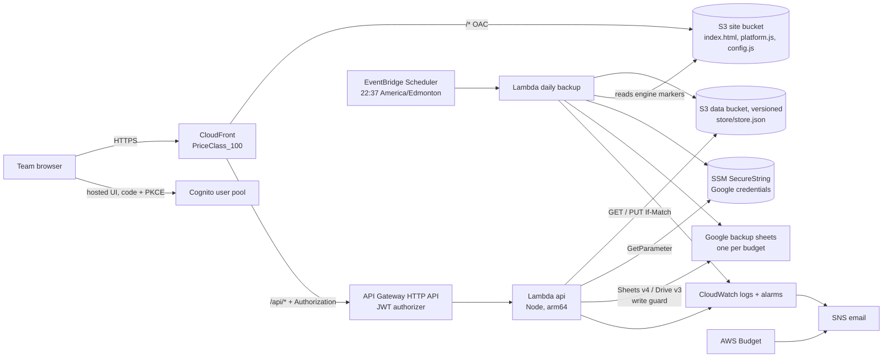
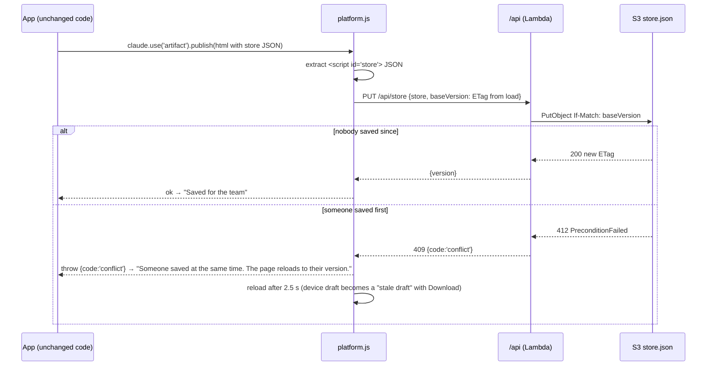
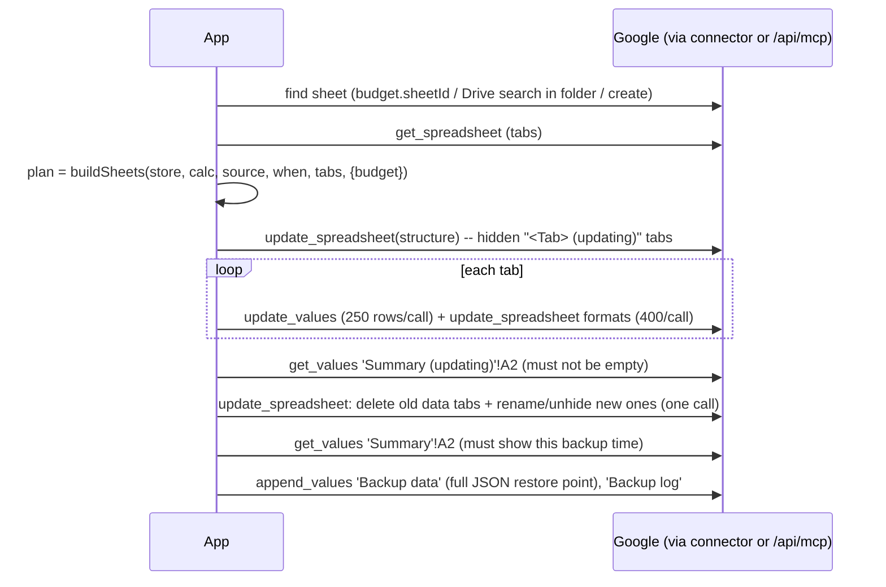

# Architecture

The product is **one self-contained HTML file** (`app/artifact/index.html`, ~540 KB): CSS, markup, all JavaScript and the
team's data (`<script id="store" type="application/json">`). It runs in two hosts with the same code:

| | Claude artifact (original, live today) | Standalone / AWS (this repo) |
|---|---|---|
| Page | published artifact HTML | `app/standalone/index.html` on S3 + CloudFront |
| Data | embedded store; **Save for team** republishes the whole page | `GET/PUT /api/store` → S3 `store/store.json` (versioned, ETag `If-Match`) |
| Host API | `window.claude.use('artifact'|'downloads'|'mcp')` | `platform.js` implements the same three objects |
| Google Sheets / Drive | Claude connectors (`mcp.callTool('Google Sheets', …)`) | `POST /api/mcp` → Lambda → Google REST with a service account, behind a write guard |
| Sign-in | Claude account + artifact sharing | Cognito user pool (hosted UI, code + PKCE), JWT authorizer on the HTTP API |
| Daily backup | Claude scheduled task, 22:37 Edmonton | EventBridge Scheduler → Lambda, 22:37 America/Edmonton |

## Code map of the single file
```
<head> <style> … design system, page CSS, story blocks (Scope A/B, upgrades, To check, QA) … </style>
<body> header (brand, pickers, save state, tabs) · sections #v-inputs #v-builder #v-investors #v-breport #v-budget #v-tocheck
       modals (#modal #dmodal #qmodal #chmodal #cmodal #vmodal #pmodal #mvmodal #tmodal #bkmodal #tcleave #busy) · #toasts
<script id="store" type="application/json"> { v:4, … } </script>
<script> {                                   // one block scope
  formatting + ranges (Rg, mkR, mergeR)
  /*ENGINE*/ function calc(p, co) … /*END*/                      → docs/logic/01-calc-engine.md
  /*BACKUP*/ function buildBackup(…) … /*ENDBACKUP*/             → docs/logic/07-backups-sheets.md
  /*SHEETS*/ function buildSheets(…) … /*ENDSHEETS*/
  template + migrate() + upgrades helpers + budFigs/resolveBudget/effP     → 03, 04
  load store / device draft · persist / markDirty                          → 06
  Inputs form, sidebar, Builder, Investor, /*BREPORT*/ report + PDF /*ENDBREPORT*/ → 02
  Budget page, upgrades UI, Backups (sheetsCall, writePlan, sheetFor, writeBackup, sync, restore) → 03, 04, 07
  saveTeam, budget actions, invoices & payments, move, item types (saveTypes, tReopen) → 03, 06
  dialogs, guard, routing, diffStores / nbar                               → 06, 08
  To check (tc*)                                                           → 05
  boot: route(); buildForm(); markDirty(); tReopen(); claude.use(...)
} </script>
```
The markers `/*ENGINE*/ /*END*/ /*BACKUP*/ /*ENDBACKUP*/ /*SHEETS*/ /*ENDSHEETS*/` are an interface: the daily backup
(Claude task and Lambda) cuts those functions out of the live page with `new Function(...)`.

## System diagram (AWS)


## Save (optimistic concurrency)


## Back up now / Save for team backup


## Data flow of a number
`input` event → `set(path)` → `persist()` (device draft) → `refresh()` → `effP(P())` (linked budget total via
`budFigs`) → `calc()` twice (low/high ranges) → `mergeR` → renderers (sidebar, Builder, reports) → Save for team →
backup sheet + team copy.

## Cost (AWS, ca-central-1, internal use: ~5 users, ~1 MB store, a few hundred saves/backups a month)
| Service | Usage | Monthly |
|---|---|---|
| CloudFront | < 1 GB, < 100k requests (always-free tier: 1 TB + 10M requests) | $0 |
| S3 site + data | < 50 MB incl. 1 year of store versions, few thousand requests | ~$0.01–0.05 |
| API Gateway HTTP API | ~20k requests ($1.00 per million; first 1M free in year 1) | ~$0.02 |
| Lambda arm64 | ~20k invocations, < 2k GB-s (free tier 1M req + 400k GB-s, permanent) | $0 |
| Cognito Lite | < 10 users (first 10,000 MAU free) | $0 |
| SSM Parameter Store | 1 standard SecureString (aws/ssm key) | $0 |
| EventBridge Scheduler | 30 invocations (14M free) | $0 |
| CloudWatch Logs | < 100 MB, 30/90-day retention (5 GB free) | $0 |
| AWS Budgets / SNS email / 2 alarms | 2 budgets free, 10 alarms free | $0 |
| **Total** | | **≈ $0.05 – $1 / month** (no NAT, no RDS, no always-on compute) |
Without the free tier the same usage stays under ~$1–2/month. The budget alarm (default $5) catches surprises.
The estimate is per environment (a `dev` stack with the samconfig defaults costs about the same or less: no daily backup,
7/14-day logs, 30-day store versions). All settings above (price class, retention, memory, schedule, budget) are template
parameters: [operations.md](operations.md#parameters). Split the bill with the `App` / `Env` / `CostCenter` tags.
